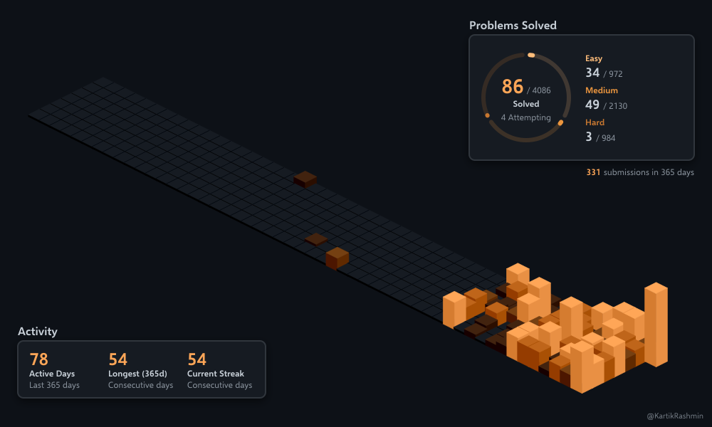
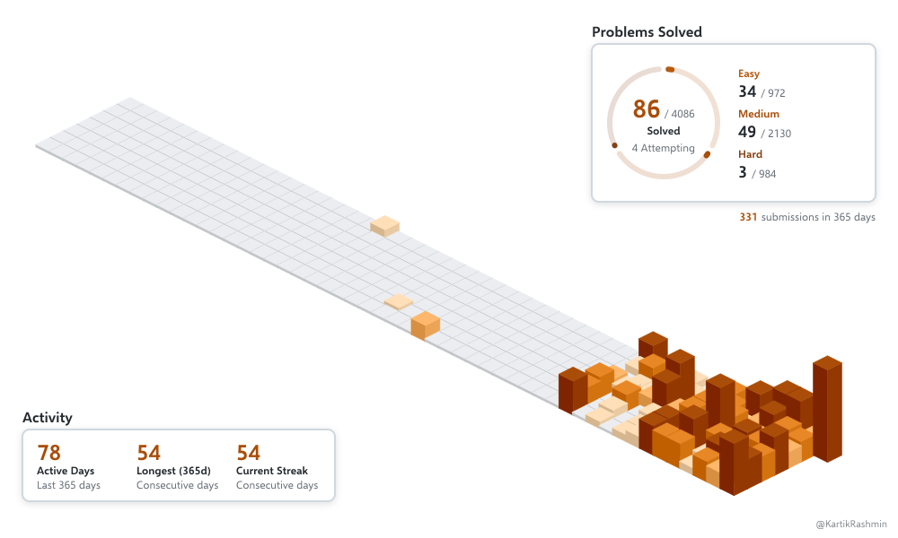

# LeetCode Isometric 3D

Generate a 365-day LeetCode activity graph as self-contained dark and light SVGs. The diagonal cubes, face shading, panel shapes, and 1000 × 600 composition come from [Spectrewolf8's isometric contribution renderer](https://github.com/Spectrewolf8/GitHub-Contributions-Isometric-3D-Graphs-Embed). This edition uses public LeetCode data, orange and brown activity colors, a solved-problems ring, and LeetCode statistics.

| Dark | Light |
| --- | --- |
|  |  |

The previews above are a [dated snapshot of `KartikRashmin`](media/leetcode/README.md); running the generator fetches fresh data for the username you choose.

## Requirements and local use

- Node.js 22 or newer, npm, and network access to LeetCode's public GraphQL endpoint.
- No LeetCode account, cookie, API key, GitHub token, database, or server is required.

```bash
git clone https://github.com/KartikRashmin/leetcode-isometric-3d.git
cd leetcode-isometric-3d
npm ci
npm run generate -- --username YOUR_LEETCODE_USERNAME --output-dir ./assets
```

This writes `assets/leetcode-isometric-dark.svg` and `assets/leetcode-isometric-light.svg`. The same filenames are used for every username so profile README links stay stable. To embed them in a GitHub profile README:

```markdown


```

The generator fetches once, renders both themes, and stages each file before replacing existing output. A fetch, parsing, or render error exits nonzero and leaves previous SVGs in place. The CLI never commits or pushes files.

### CLI options

```text
node generate.js --username <name> [--theme dark|light|both]
  [--output-dir <directory>] [--output <file.svg>]
  [--width <pixels> --height <pixels>] [--heading <text>]
  [--no-stats] [--no-credit]
```

`--theme both` is the default. Use `--output` only with one theme. The default display size is 1000 × 600; custom dimensions must retain the 5:3 ratio, for example `--width 500 --height 300`. The SVG keeps the 1000 × 600 viewBox and graph geometry. `--heading` changes the solved panel title. `--no-stats` hides the two statistics panels; `--no-credit` hides the small username credit. Run `npm run generate -- --help` for the complete option list.

Examples:

```bash
npm run generate -- --username KartikRashmin --theme light --output ./light.svg
npm run generate -- --username another.user --output-dir ./dist --width 500 --height 300
npm run generate -- --username another.user --no-credit --heading 'Problems Solved'
```

## Reusable GitHub Action

This repository's [`action.yml`](action.yml) is a composite Action. It installs the generator in the Action checkout and writes SVGs into the caller's workspace. It does not commit, push, or change the caller's README. The caller controls those steps.

```yaml
permissions:
  contents: read

steps:
  - uses: actions/checkout@v7
  - uses: KartikRashmin/leetcode-isometric-3d@feat/leetcode-isometric-mvp
    with:
      username: YOUR_LEETCODE_USERNAME
      output-dir: assets
```

The feature branch ref above is available before the first release. Switch to `@v1` after that tag is actually published; no release tag is created by this project milestone. The Action itself needs only read access; the example below grants `contents: write` because it commits SVGs. For a full scheduled workflow, copy [`examples/workflows/update-leetcode.yml`](examples/workflows/update-leetcode.yml) to **your own repository's** `.github/workflows/update-leetcode.yml`, replace the username, and adjust `output-dir` and README paths. Scheduled workflows run from the caller repository's default branch, and protected branches may require a PR instead of the example's direct push.

| Action input | Default | Purpose |
| --- | --- | --- |
| `username` | required | Public LeetCode username |
| `output-dir` | `assets` | Destination in caller workspace |
| `width`, `height` | `1000`, `600` | Display size at a 5:3 ratio |
| `heading` | `Problems Solved` | Solved panel heading |
| `show-stats` | `true` | Show solved and activity panels |
| `show-credit` | `true` | Show username credit |

The Action exposes `dark-svg` and `light-svg` outputs as absolute file paths. A generation failure makes the Action fail, so the example workflow cannot commit stale or partial output from that run. See [GitHub's composite Action documentation](https://docs.github.com/en/actions/tutorials/create-actions/create-a-composite-action) for Action execution details.

## What the graph shows

- **Cubes:** one per UTC day in the trailing 365-day window. Cube height reflects that day's submission count; the five orange levels are chosen from active-day quartiles. Zero submissions are shown at level 0.
- **Solved ring and totals:** all-time *distinct accepted problems* from LeetCode's public solved counts. The three orange ring segments are Easy, Medium, and Hard, each filled by solved divided by available questions at that difficulty. Their headings use cyan, orange, and red.
- **Activity panel:** active days and longest streak within the displayed 365-day window. The submission count appears below the solved panel.

Submission totals can exceed distinct problems solved because repeated submissions count as activity. The graph's date window is calculated in UTC. Statistics and palettes are supplied by [`src/leetcode-data.js`](src/leetcode-data.js), [`src/leetcode-stats.js`](src/leetcode-stats.js), and [`src/leetcode-theme.js`](src/leetcode-theme.js); the original isometric projection and shading remain in [`src/renderer.js`](src/renderer.js) and [`src/svg-renderer.js`](src/svg-renderer.js).

## Development and release checks

```bash
npm ci
npm test
npm audit
```

The offline tests cover LeetCode parsing, UTC activity and streaks, unchanged cube geometry, SVG panel rendering, CLI error handling, multiple usernames, and the composite Action's actual generation step. A live CLI run needs LeetCode availability and may be rate limited; on a failure, the previous good assets remain available. The project currently ships a CLI and Action, not a hosted API. First public release still requires an owner review of the generated images and a release tag.

Pushes to `feat/leetcode-isometric-mvp` run the [release validation workflow](.github/workflows/ci.yml) on a GitHub-hosted runner. It checks dependencies and offline tests, calls the Action with `uses: ./`, verifies live SVG statistics and visual elements, and uploads both themes as a downloadable artifact for review.

## Attribution and licenses

The isometric renderer is derived from [Spectrewolf8/GitHub-Contributions-Isometric-3D-Graphs-Embed](https://github.com/Spectrewolf8/GitHub-Contributions-Isometric-3D-Graphs-Embed), and its projection uses the bundled MIT-licensed Obelisk code. The LeetCode data integration was informed by [shailesh-hacker/leetcode-calander-svg](https://github.com/shailesh-hacker/leetcode-calander-svg). This is an independent fork, not an official edition from either author or LeetCode.

The repository's upstream MIT license is retained in [`LICENSE`](LICENSE). The bundled Selawik and Noto Sans Symbols fonts use SIL Open Font License 1.1; their source and license texts are documented in [`fonts/README.md`](fonts/README.md). Legacy Segoe binaries were removed before release preparation.

The small logo mark is embedded from [LeetCode's official SVG asset](https://assets.leetcode.com/static_assets/public/webpack_bundles/images/logo-dark.e99485d9b.svg), with its dark stroke adapted for each theme. The LeetCode name and logo belong to LeetCode, LLC and are excluded from this repository's MIT license. This project is not affiliated with or endorsed by LeetCode.
